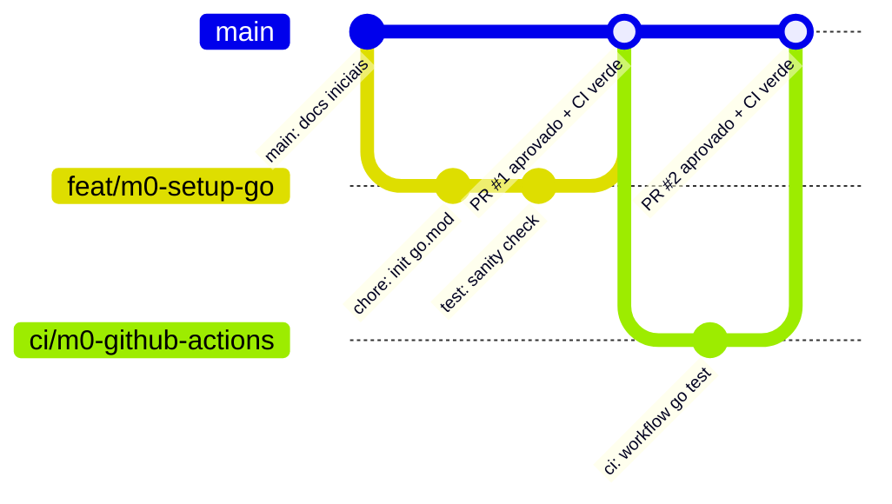

# Guia de Contribuição — `mecly`

Obrigado pelo interesse em contribuir com o **`mecly`**! Este documento define como trabalhamos em dupla (**`@dultradev`** e **`@arthurd-rios`**) e como a comunidade pode participar mantendo a qualidade técnica e o propósito educacional do projeto.

---

## Política de Uso de IA

> [!CAUTION]
> **Regra de Ouro deste Projeto:** Inteligência Artificial **não escreve o código de produção nem os testes** do `mecly`.

Este repositório existe para construirmos domínio real de **Go**, **Arquitetura de Software**, **Testes** e **System Design**. Por isso, adotamos uma fronteira clara:

| Permitido (IA como Mentora / Consulta) | Não Permitido (IA como Autora) |
| :--- | :--- |
| Tirar dúvidas conceituais sobre Go, redes, bancos de dados, Docker ou CI/CD | Pedir para a IA gerar arquivos `.go`, handlers, testes ou migrations prontas e colar no projeto |
| Pedir revisão conceitual de uma abordagem ou comparação de trade-offs | Submeter Pull Requests com código gerado por IA sem autoria real |
| Usar como apoio para depurar um erro entendendo a causa raiz | Aceitar sugestões automáticas ("Tab-driven coding") de blocos inteiros sem entender cada linha |
| Estruturar documentação, roteiros de estudo e organização de tarefas | Substituir a leitura da documentação oficial e o exercício de pensar na solução |

> [!TIP]
> **Teste simples antes de abrir um PR:** se o seu parceiro perguntar *"por que você escolheu essa interface/estrutura nessa linha?"* durante o Code Review, você deve conseguir explicar com as próprias palavras.

---

## Fluxo de Trabalho: GitHub Flow

Usamos **GitHub Flow** — simples, direto e ideal para uma equipe enxuta com integração contínua (sem branches longas de `develop`, `release` ou `hotfix`):



### Passo a passo para cada tarefa

1. **Escolha uma Sub-issue** na coluna `Ready` do [**GitHub Projects**](https://github.com/users/dultradev/projects/2), atribua a você e mova para `In Progress`.
2. **Atualize sua `main` local** e crie uma branch curta e descritiva:
   ```bash
   git checkout main
   git pull origin main
   git checkout -b feat/12-base62-encoder
   ```
   **Padrão de nomes de branch:**
   - `feat/<numero-issue>-descricao-curta` — nova funcionalidade
   - `fix/<numero-issue>-descricao-curta` — correção de bug
   - `docs/<numero-issue>-descricao-curta` — documentação e ADRs
   - `ci/<numero-issue>-descricao-curta` — pipelines e automações
   - `refactor/<numero-issue>-descricao-curta` — refatoração sem mudança de comportamento
   - `chore/<numero-issue>-descricao-curta` — manutenção, setup e tarefas auxiliares

3. **Desenvolva com TDD** (ver seção abaixo) fazendo commits pequenos e atômicos.
4. **Rode as verificações locais** antes de subir:
   ```bash
   gofmt -l .
   go vet ./...
   go test -race -v ./...
   ```
5. **Abra um Pull Request** para `main`:
   - Vincule a issue na descrição com `Closes #<numero>` (fecha automaticamente ao fazer merge).
   - Mova a tarefa no board para `In Review`.
   - Aguarde o **CI (GitHub Actions)** ficar verde e a **revisão do parceiro**.
6. **Faça o Merge** (preferencialmente *Squash and Merge* ou *Merge Commit* limpo) e apague a branch remota após o merge.

---

## Padrão de Commits (Conventional Commits)

Seguimos [Conventional Commits](https://www.conventionalcommits.org/pt-br/v1.0.0/) para manter o histórico legível e facilitar changelogs futuros:

```text
<tipo>(<escopo opcional>): <descrição curta no imperativo>
```

| Tipo | Quando usar | Exemplo |
| :--- | :--- | :--- |
| `feat` | Nova funcionalidade de negócio ou endpoint | `feat(shortener): implement base62 encoder and decoder` |
| `fix` | Correção de bug | `fix(http): return 404 when shortcode is not found` |
| `test` | Adição ou ajuste exclusivo de testes | `test(memory): add concurrency race tests for repository` |
| `refactor` | Melhoria interna sem alterar comportamento externo | `refactor(shortener): split writer and reader ports` |
| `docs` | Documentação, README, ROADMAP e ADRs | `docs(adr): add ADR-001 base62 vs hash strategy` |
| `ci` | Workflows de GitHub Actions e pipelines | `ci: run go vet and race detector on pull requests` |
| `chore` | Setup do módulo, configs e manutenção | `chore: initialize go module and base directories` |

---

## Desenvolvimento Orientado a Testes (TDD)

Nosso desenvolvimento segue o ciclo **Red → Green → Refactor**:

1. **Red:** escreva primeiro um teste que descreva o comportamento esperado (e veja ele falhar).
2. **Green:** escreva o código mais simples que faça o teste passar.
3. **Refactor:** melhore clareza, nomes e design mantendo todos os testes verdes.

### Boas práticas de teste em Go que adotamos

- **Table-Driven Tests** para validar múltiplos cenários e casos de borda sem duplicar código.
- **Race Detector sempre ligado (`-race`)** para detectar condições de corrida desde a Milestone 1.
- **Contract Tests** (`internal/shortener/shortenertest/`) para garantir que qualquer novo adaptador (`memory`, `postgres`, `redis`, etc.) cumpra rigorosamente o mesmo contrato de comportamento.
- **Sem dependências externas no Core:** testes unitários de domínio e casos de uso devem rodar em milissegundos, sem Docker nem rede.

---

## Gestão no GitHub Projects

Organizamos o projeto de forma incremental — **planejamos e executamos uma Milestone por vez**, evitando superplanejamento de tarefas distantes:

- **Milestone:** agrupa uma entrega de valor fechada (ex.: `M0: Fundação & Gestão`).
- **Epic (Issue Pai):** descreve o objetivo completo da milestone, decisões técnicas e lista suas tarefas filhas via **Sub-issues** do GitHub.
- **Task (Sub-issue):** unidade atômica de trabalho, com escopo claro, critérios de aceite e estimativa de **Size / Effort**:
  - `XS` — ajuste rápido (< 1h)
  - `S` — tarefa direta (1–3h)
  - `M` — tarefa com estudo + implementação (meio dia a 1 dia)
  - `L` — épico ou entrega composta (vários dias; prefira quebrar em sub-issues `S`/`M`)

### Colunas do Board

`Backlog` → `Ready` → `In Progress` → `In Review` → `Done`

---

## Guia de Code Review entre a Dupla

Code Review no `mecly` não é burocracia — é uma das principais ferramentas de aprendizado da dupla:

- **Para quem abre o PR:** mantenha PRs pequenos e focados em uma única Sub-issue. Preencha o template explicando *o que* mudou, *por quê* e *como testar*.
- **Para quem revisa:**
  - Verifique se os **critérios de aceite** da issue foram cumpridos.
  - Avalie legibilidade, tratamento de erros em Go, fronteiras de arquitetura (ex.: um módulo não importando outro indevidamente) e cobertura de testes.
  - Faça perguntas curiosas (*"o que acontece se chegar uma URL vazia aqui?"*) em vez de críticas ríspidas.
  - Aprove apenas quando o CI estiver verde e você entender a mudança.

---

## Adicionando Novos Adaptadores (Comunidade)

Quer plugar seu banco de dados (SQLite, MySQL, MongoDB…) ou cache (Memcached, Dragonfly…)?

1. Crie uma pasta isolada em `internal/adapters/storage/<nome>` ou `internal/adapters/cache/<nome>`.
2. Mantenha quaisquer migrations ou schemas **dentro da pasta do seu adaptador** (nunca na raiz do projeto).
3. Implemente as interfaces segregadas definidas em `internal/shortener/ports.go`.
4. Execute a suíte de **Contract Tests** (`internal/shortener/shortenertest/`) contra o seu adaptador para comprovar conformidade total.
