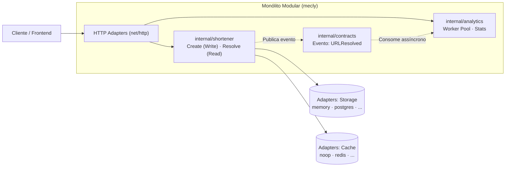

# mecly (`mec.ly/`)

> Encurtador de URLs **Open Source** em **Go**, construído como laboratório prático de **Arquitetura de Software**, **Monólito Modular**, **TDD** e **System Design** — rápido, transparente, **sem anúncios** e desenhado para que qualquer pessoa consiga trocar banco de dados, cache ou frontend.

---

## Visão do Projeto

O **`mecly`** nasceu com dois objetivos complementares:

1. **Aprendizado real de Engenharia de Software:** aplicar na prática conceitos de **System Design**, **Go idiomático**, **desenvolvimento orientado a testes (TDD)**, **CI/CD** e **arquitetura desacoplada** construindo um produto real que rodará em produção no domínio **`mec.ly/`**.
2. **Software Open Source plugável:** permitir que a comunidade use, estude e adapte o projeto escolhendo livremente suas tecnologias de **persistência** (Memória, PostgreSQL, SQLite, MySQL, NoSQL…), **cache** (Noop, Redis, Memcached…) e **frontend** (qualquer cliente HTTP/REST).

> [!IMPORTANT]
> **Compromisso de Autoria (Política de IA):** neste projeto, ferramentas de Inteligência Artificial são usadas **exclusivamente como mentoria e consulta** (dúvidas conceituais, revisões de arquitetura e referências de estudo) — nunca para escrever o código da aplicação por nós. Veja os detalhes em [`CONTRIBUTING.md`](CONTRIBUTING.md#pol%C3%ADtica-de-uso-de-ia).

---

## Fundamentos de System Design

Antes da primeira linha de código, o projeto partiu do levantamento de requisitos, estimativas de escala e escolhas arquiteturais:

| Requisito / Estimativa | Valor Alvo | Decisão Arquitetural |
| :--- | :--- | :--- |
| **Escrita (Criação)** | 100M URLs/dia (~1.160 TPS) | Caminho de escrita (`Create`) isolado com foco em **consistência forte**. |
| **Leitura (Redirect)** | Proporção **10:1** (~11.600 TPS) | Caminho de leitura (`Resolve`) isolado e otimizado para **Cache-Aside** e eventual Read Replica. |
| **Retenção & Capacidade** | 10 anos = **365 bilhões** de registros (~36,5 TB) | **Base62 (`0-9A-Za-z`)** com até **7 caracteres** ($62^7 \approx 3{,}52$ trilhões de combinações). |
| **Geração do Shortcode** | ID numérico único → Base62 (ex.: `1345` → `Lh`) | Elimina colisões de hash truncado na escrita; abstraído atrás da porta `IDGenerator`. |
| **Redirecionamento** | `GET /{code}` → **HTTP `302 Found`** | Passa pelo servidor para **metrificação de cliques (sem anúncios)**, evitando cache permanente de `301`. |

### Endpoints Planejados

| Método | Rota | Descrição | Resposta Principal |
| :--- | :--- | :--- | :--- |
| `POST` | `/api/v1/shorten` | Recebe `{"url": "https://..."}` e gera a URL curta | `201 Created` — `{"short_url": "https://mec.ly/Lh"}` |
| `GET` | `/{code}` | Resolve o shortcode e redireciona para a URL original | `302 Found` — Header `Location: https://...` |
| `GET` | `/api/v1/urls/{code}/stats` | Retorna métricas de acesso do link *(Milestone 4)* | `200 OK` — contagem e metadados |
| `GET` | `/health` | Verifica saúde da aplicação *(Milestone 2)* | `200 OK` |

---

## Arquitetura em Alto Nível

O `mecly` é um **Monólito Modular** guiado por **Ports & Adapters**, **separação Write/Read (CQRS-lite)** e **Eventos de Domínio**:

### Pilares Arquiteturais

- **Zero dependência externa no Core:** as milestones iniciais (`M0`–`M2`) usam apenas a **biblioteca padrão do Go** (`net/http`, `log/slog`, `testing`, `sync`). Drivers de infraestrutura entram apenas dentro de `internal/adapters/`.
- **Adaptadores 100% autocontidos:** não há pasta `migrations/` na raiz — cada adaptador de banco gerencia seu próprio schema (ex.: `internal/adapters/storage/postgres/migrations/`).
- **Módulos realmente desacoplados:** `shortener` **não importa** `analytics` (e vice-versa). A comunicação acontece via evento de integração (`URLResolved`) definido em `internal/contracts/` e roteado pelo Event Bus no `cmd/mecly/main.go`.
- **Contract Tests reutilizáveis:** suítes em `internal/shortener/shortenertest/` validam qualquer novo adaptador de storage ou cache contra o mesmo contrato comportamental.

> Para a arquitetura completa, estrutura de pastas, diagramas de sequência e guia de estudos por fase, leia o [**`docs/ROADMAP.md`**](docs/ROADMAP.md).

---

## Status do Roadmap

Acompanhamos o progresso via Milestones, Epics e Sub-issues no [**GitHub Projects — Backlog · Encurtador de URL em Go**](https://github.com/users/dultradev/projects/2):

- [ ] **M0 — Fundação, CI/CD e Governança** *(Em andamento)*
- [ ] **M1 — Core Domain, Base62 e Storage In-Memory (TDD)**
- [ ] **M2 — API HTTP (`net/http`) e MVP Executável (`v0.1.0`)**
- [ ] **M3 — Persistência com PostgreSQL e Docker**
- [ ] **M4 — Cache Redis (10:1), Event Bus e Módulo Analytics**
- [ ] **M5 — Hardening, OpenAPI e Deploy em Produção (`mec.ly/` — `v1.0.0`)**

---

## Como Contribuir

Contribuições são muito bem-vindas — especialmente novos adaptadores de storage/cache, melhorias de documentação e revisões construtivas!

Antes de abrir seu primeiro Pull Request, leia o [**`CONTRIBUTING.md`**](CONTRIBUTING.md) para entender nosso **GitHub Flow**, o ciclo **TDD** e nossa **Política de Uso de IA**.

---

## Mantenedores

Projeto idealizado e mantido em parceria por:

- **[@dultradev](https://github.com/dultradev)**
- **[@arthurd-rios](https://github.com/arthurd-rios)**

---

## Licença

Este projeto está licenciado sob a **Licença MIT**. Consulte o arquivo `LICENSE` (adicionado na evolução do repositório) para mais detalhes.
