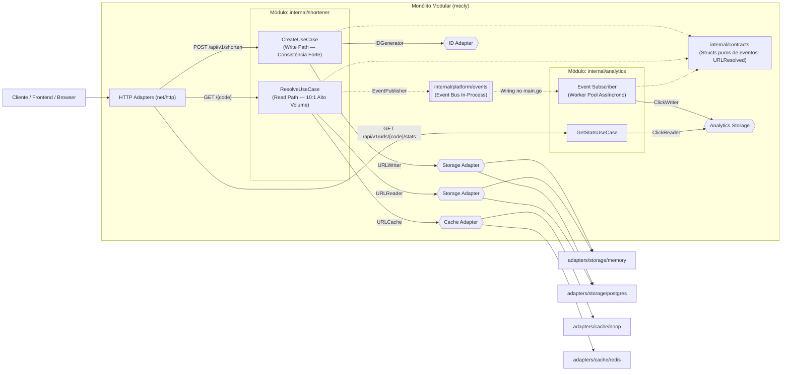
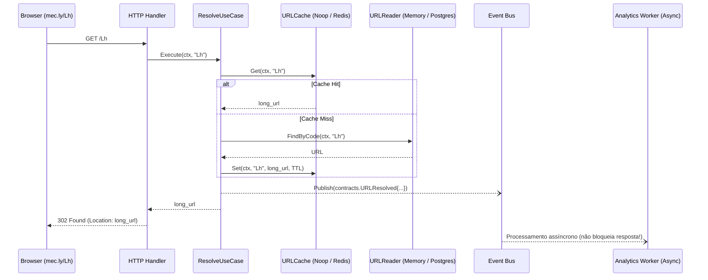
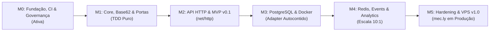

# Roadmap & Arquitetura — `mecly` (`mec.ly/`)

> Documento técnico mestre do projeto **`mecly`**, mantido por **`@dultradev`** e **`@arthurd-rios`**. Serve como bússola arquitetural, registro do System Design e guia de evolução incremental por Milestones.

---

## 1. Premissas e Requisitos de System Design

Todo o desenho do `mecly` nasce dos requisitos funcionais, não funcionais e estimativas de capacidade levantados na etapa conceitual:

### Requisitos Funcionais

1. **Encurtamento de URL:** a partir de uma URL longa válida, gerar e persistir uma URL curta no domínio `mec.ly/`.
2. **Redirecionamento de URL:** a partir de um shortcode (`GET /{code}`), redirecionar o usuário para a URL original com **HTTP `302 Found`**, passando pelo servidor apenas para metrificação (sem anúncios).
3. **Metrificação (Evolução M4):** contabilizar cliques de forma assíncrona sem impactar a latência do redirecionamento e expor estatísticas básicas via API.

### Requisitos Não Funcionais e Estimativas

| Métrica | Cálculo / Meta | Consequência Arquitetural |
| :--- | :--- | :--- |
| **Escrita (Write TPS)** | $100.000.000 / 86.400 \approx \mathbf{1.160\text{ TPS}}$ | Escrita exige **consistência forte** e geração de código sem colisões. |
| **Leitura (Read TPS)** | Proporção **10:1** → $\mathbf{11.600\text{ TPS}}$ | Leitura domina o sistema → **Cache-Aside** (Redis) + separação de portas Read/Write. |
| **Volume em 10 anos** | $100\text{M} \times 365 \times 10 = \mathbf{365\text{ bilhões}}$ de URLs | Espaço de códigos precisa superar 365B com margem de segurança. |
| **Armazenamento** | $365\text{B} \times 100\text{ bytes} \approx \mathbf{36{,}5\text{ TB}}$ | Schema compacto e índices enxutos. |
| **Shortcode** | **Base62 (`0-9A-Za-z`)**, até **7 caracteres** | $62^7 = 3.521.614.606.208$ (~3,52 trilhões de combinações). |
| **Disponibilidade** | 24/7 com tolerância a falhas | Cache deve degradar graciosamente se cair; analytics nunca pode derrubar o redirect. |

### Decisão de Codificação: Base62 a partir de ID Numérico

- **Alfabeto padronizado:** `0123456789ABCDEFGHIJKLMNOPQRSTUVWXYZabcdefghijklmnopqrstuvwxyz` (`0-9` = `0..9`, `A-Z` = `10..35`, `a-z` = `36..61`).
- **Exemplo de referência para TDD:**
  - $1345 \div 62 = 21$ com resto $43$ → caractere `'h'`
  - $21 \div 62 = 0$ com resto $21$ → caractere `'L'`
  - Resultado: **`1345` → `"Lh"`** (e decode `"Lh"` → `1345`).
- **Por que não hash truncado (ex.: SHA-256 com 6 hex)?** Pelo Paradoxo do Aniversário, 6 caracteres hexadecimais (~16,7M combinações) já atingem alta probabilidade de colisão em poucos milhares/milhões de registros e exigem round-trips extras de verificação no banco.
- **Evolução futura prevista:** IDs sequenciais são previsíveis/enumeráveis (`1`, `2`, `3`...). Como a geração de IDs fica isolada atrás da interface `IDGenerator`, poderemos evoluir futuramente para offset, ofuscação bijetiva ou Snowflake sem alterar a regra de negócio.

---

## 2. Arquitetura: Monólito Modular + Ports & Adapters

O `mecly` segue **Monólito Modular** com quatro regras estruturais rígidas:

1. **Baixo acoplamento e plugabilidade real:** o núcleo de negócio depende apenas de **interfaces pequenas** definidas pelo consumidor (*Accept interfaces, return structs*). Banco de dados, cache e frontend são intercambiáveis.
2. **Separação de Write (`Create`) e Read (`Resolve`) — CQRS-lite:** como a leitura é 10x maior que a escrita e tem requisitos distintos (cache + eventos vs. consistência forte + geração de ID), separamos tanto os **casos de uso** (`create.go` e `resolve.go`) quanto as **portas de persistência** (`URLWriter` e `URLReader`). Isso permite até apontar `URLReader` para uma Read Replica no futuro sem tocar no domínio.
3. **Desacoplamento horizontal via Eventos de Domínio (`internal/contracts`):** em um Monólito Modular, o módulo `shortener` **jamais pode importar** `analytics` (e vice-versa). O `shortener` apenas publica um evento de integração `URLResolved` (definido no kernel compartilhado mínimo `internal/contracts/`) através de uma interface `EventPublisher`. O `cmd/mecly/main.go` (Composition Root) conecta o `analytics` como assinante desse evento no Event Bus (`internal/platform/events`).
4. **Adaptadores 100% autocontidos:** cada adaptador de banco é dono dos seus próprios artefatos (ex.: `migrations/` mora dentro de `internal/adapters/storage/postgres/migrations/`, nunca na raiz do projeto).

### Diagrama de Módulos e Dependências



### Fluxo de Redirecionamento `302 Found` (M4)



### Estrutura de Diretórios Alvo

```text
mecly/
├── .github/
│   ├── workflows/
│   │   └── ci.yml                       # [M0] Pipeline de CI (gofmt, go vet, go test -race)
│   └── pull_request_template.md         # [M0] Template padrão de PR (GitHub Flow)
├── cmd/
│   └── mecly/
│       └── main.go                      # [M0/M2] Composition Root (config, wiring, graceful shutdown)
├── internal/
│   ├── contracts/                       # [M4] Contratos de eventos entre módulos (ex.: URLResolved)
│   │   └── events.go                    #      Zero lógica de negócio — evita acoplamento horizontal!
│   ├── platform/                        # Infraestrutura compartilhada sem regra de negócio
│   │   ├── config/                      # [M2] Carregamento de variáveis de ambiente
│   │   ├── events/                      # [M4] Implementação do Event Bus in-process
│   │   ├── httpserver/                  # [M2] net/http server, middlewares, healthcheck
│   │   └── observability/               # [M2] Logs estruturados com log/slog
│   ├── shortener/                       # Módulo 1: Encurtamento & Redirecionamento
│   │   ├── domain.go                    # [M1] Entidade URL, validação e erros sentinela
│   │   ├── base62.go                    # [M1] Conversão Base62 (0-9A-Za-z) pura + base62_test.go
│   │   ├── ports.go                     # [M1] Interfaces segregadas: URLWriter, URLReader, URLCache, IDGenerator, EventPublisher
│   │   ├── create.go                    # [M1] Caso de uso Write (consistência forte) + create_test.go
│   │   ├── resolve.go                   # [M1] Caso de uso Read (cache-aside + evento) + resolve_test.go
│   │   ├── http_handler.go              # [M2] POST /api/v1/shorten e GET /{code} + http_handler_test.go
│   │   └── shortenertest/               # [M1] Contract Test Suites (padrão net/http/httptest!)
│   │       ├── repository_contract.go   #      Testes compartilhados para memory, postgres, sqlite...
│   │       └── cache_contract.go        # [M4] Testes compartilhados para noop, redis, memcached...
│   ├── analytics/                       # Módulo 2: Metrificação de Cliques (independente do shortener)
│   │   ├── domain.go                    # [M4] Modelo de clique/métrica
│   │   ├── ports.go                     # [M4] ClickWriter, ClickReader
│   │   ├── subscriber.go                # [M4] Consome contracts.URLResolved via Worker Pool
│   │   ├── stats.go                     # [M4] Caso de uso GetStats
│   │   └── http_handler.go              # [M4] GET /api/v1/urls/{code}/stats
│   └── adapters/                        # Adaptadores plugáveis e autocontidos
│       ├── storage/
│       │   ├── memory/                  # [M1] Thread-safe (sync.RWMutex + atomic) + chama shortenertest
│       │   └── postgres/                # [M3] Adapter PostgreSQL + chama shortenertest
│       │       └── migrations/          # [M3] Migrations SQL pertencem ao adapter Postgres!
│       └── cache/
│           ├── noop/                    # [M1] Null Object Pattern (sem cache)
│           └── redis/                   # [M4] Redis Cache-Aside com graceful degradation
├── docs/
│   ├── ROADMAP.md                       # Este documento
│   └── adr/                             # [M0] Architecture Decision Records
├── .gitignore                           # Ignora issues/ (temporária), binários Go, .env, etc.
├── README.md
└── CONTRIBUTING.md
```

> [!NOTE]
> **Onde moram os Contract Tests e o Contrato de Eventos?**
> - **Contract Tests (`internal/shortener/shortenertest/`):** seguimos a convenção idiomática da biblioteca padrão do Go (`net/http/httptest`, `io/iotest`). Um subpacote `*test` exporta funções de teste (`RunRepositoryContract(t, factory)`) que são importadas apenas pelos `*_test.go` de cada adaptador (`memory`, `postgres`, etc.), sem inflar o binário de produção.
> - **Contrato do Evento `URLResolved` (`internal/contracts/`):** atua como um *Shared Kernel* mínimo contendo apenas structs puros de eventos de integração. Assim, `shortener` e `analytics` importam apenas `internal/contracts`, jamais um ao outro — e se um dia `analytics` virar um microsserviço via fila (Kafka/RabbitMQ), esse pacote já representa o payload da mensagem.

---

## 3. Evolução por Milestones

Trabalhamos **uma Milestone por vez** (criando Epic + Sub-issues no GitHub Projects apenas para a milestone ativa). Abaixo está a visão estratégica completa de `M0` até `M5`:



### Milestone 0 — Fundação, CI/CD e Governança *(Ativa)*
- **Objetivo:** estabelecer o módulo Go (`mecly`), estrutura inicial de diretórios, primeiro pipeline de CI com **GitHub Actions**, governança com **GitHub Flow** (Branch Protection + PR Template) e os **3 ADRs iniciais** documentando o System Design.
- **Aprendizados-chave:** `go.mod`, ferramentas nativas (`gofmt`, `go vet`, `go test -race`), fundamentos de CI/CD no GitHub Actions, GitHub Flow, Code Review e escrita de ADRs.

### Milestone 1 — Core Domain, Base62 e Storage In-Memory (TDD Puro)
- **Objetivo:** construir 100% da regra de negócio com **zero dependências externas**: algoritmo Base62 (`0-9A-Za-z`), entidade `URL` e validações (incluindo prevenção de loop de redirecionamento para o próprio `mec.ly`), portas segregadas (`URLWriter`, `URLReader`, `IDGenerator`), adaptador `memory` thread-safe com suíte `shortenertest` e casos de uso `Create` e `Resolve`.
- **Aprendizados-chave:** TDD em Go, Table-Driven Tests, erros sentinela (`errors.Is`/`errors.As`), interfaces implícitas, concorrência básica (`sync.RWMutex`, `sync/atomic`) e Contract Tests.

### Milestone 2 — API HTTP (`net/http`) e MVP Executável (`v0.1.0`)
- **Objetivo:** entregar o primeiro binário executável funcional ponta a ponta usando apenas a stdlib (`net/http` com roteamento do Go 1.22+): `POST /api/v1/shorten`, `GET /{code}` (`302 Found`), `GET /health`, configuração via env vars, logs estruturados (`log/slog`), middlewares (logging, recovery), graceful shutdown e testes de integração E2E com `httptest`.
- **Aprendizados-chave:** `net/http` moderno, `encoding/json`, `context.Context`, `httptest`, `os/signal`, Composition Root (`cmd/mecly/main.go`).

### Milestone 3 — Persistência Real com PostgreSQL e Docker
- **Objetivo:** provar na prática a arquitetura plugável adicionando `internal/adapters/storage/postgres` (com `migrations/` internas) e `docker-compose.yml` **sem alterar uma única linha do domínio `internal/shortener`**. Validar o adaptador rodando exatamente a mesma suíte `shortenertest` e permitir seleção via `STORAGE_DRIVER=memory|postgres`.
- **Aprendizados-chave:** Docker Compose, modelagem SQL e índices (`BIGINT` + `short_code` único), `pgx`/`database/sql`, pooling de conexões e testes de integração com banco real.

### Milestone 4 — Escala 10:1: Cache Redis, Event Bus e Módulo Analytics
- **Objetivo:** endereçar a proporção 10:1 de leitura/escrita e a metrificação sem anúncios:
  1. Port `URLCache` + adaptadores `noop` e `redis` (Cache-Aside com TTL e *graceful degradation* caso o Redis fique indisponível).
  2. Contrato `contracts.URLResolved` + Event Bus in-process (`internal/platform/events`).
  3. Módulo `internal/analytics` consumindo eventos de forma assíncrona via **Goroutines + Buffered Channel + Worker Pool** + endpoint `GET /api/v1/urls/{code}/stats`.
  4. Benchmarks (`testing.B`) e teste de carga local comparando latência e throughput com e sem Redis.
- **Aprendizados-chave:** padrão Cache-Aside, TTL, Goroutines, Channels, Worker Pool, Graceful Drain de eventos, `testing.B` e benchmarking de carga.

### Milestone 5 — Hardening, Comunidade Open Source e Deploy na VPS (`v1.0.0`)
- **Objetivo:** colocar **`mec.ly/`** no ar com segurança e preparar o repositório para a comunidade e recrutadores: rate limiting por IP, `http.MaxBytesReader`, CORS configurável para frontends externos, `Dockerfile` multi-stage, reverse proxy com HTTPS automático (Caddy ou Nginx + Let's Encrypt), especificação OpenAPI 3.0 e guia de criação de adaptadores.
- **Aprendizados-chave:** segurança de APIs HTTP, Docker multi-stage builds, TLS/HTTPS em VPS Linux, OpenAPI e empacotamento Open Source.

---

## 4. Biblioteca de Referências de Estudo

Curadoria viva de documentações, artigos, vídeos e discussões para estudar ao longo do projeto (em Go e em Engenharia de Software):

### Go & Testes
- [A Tour of Go](https://go.dev/tour/) — ponto de partida interativo oficial da linguagem.
- [Effective Go](https://go.dev/doc/effective_go) — guia oficial de idiomas, nomes, interfaces e concorrência.
- [Learn Go with Tests](https://quii.gitbook.io/learn-go-with-tests/) — livro gratuito focado exatamente em aprender Go via TDD (altamente recomendado para M1 e M2!).
- [Go Blog — Routing Enhancements for Go 1.22](https://go.dev/blog/routing-enhancements) — como fazer roteamento REST moderno usando só `net/http`.
- [Go Wiki — TableDrivenTests](https://go.dev/wiki/TableDrivenTests) e [Data Race Detector](https://go.dev/doc/articles/race_detector).
- [Go Modules Reference](https://go.dev/ref/mod) e [Organizing a Go Module](https://go.dev/doc/modules/layout).

### Arquitetura, Monólito Modular & System Design
- [Martin Fowler — MonolithFirst](https://martinfowler.com/bliki/MonolithFirst.html) e [CQRS](https://martinfowler.com/bliki/CQRS.html).
- [Alistair Cockburn — Hexagonal Architecture (Ports & Adapters)](https://alistair.cockburn.us/hexagonal-architecture/).
- [Three Dots Labs — Wild Workouts / Go Architecture Series](https://threedots.tech/post/introducing-clean-architecture/) — excelentes artigos práticos sobre arquitetura limpa, CQRS e eventos em Go.
- [MADR — Markdown Architectural Decision Records](https://adr.github.io/madr/) — padrão leve para escrever ADRs.
- [ByteByteGo — Design a URL Shortener (Base62, 301 vs 302, Scale)](https://bytebytego.com/courses/system-design-interview/design-a-url-shortener) — referência clássica alinhada com o estudo da dupla.

### GitHub Flow, CI/CD & GitHub Actions
- [GitHub Docs — GitHub Flow](https://docs.github.com/pt/get-started/using-github/github-flow).
- [GitHub Docs — Entendendo o GitHub Actions](https://docs.github.com/pt/actions/about-github-actions/understanding-github-actions).
- [GitHub Docs — Building and Testing Go](https://docs.github.com/en/actions/use-cases-and-examples/building-and-testing/building-and-testing-go).
- [Conventional Commits v1.0.0](https://www.conventionalcommits.org/pt-br/v1.0.0/).
- [Google Engineering Practices — How to Do a Code Review](https://google.github.io/eng-practices/review/).

### Infraestrutura (Milestones Futuras: M3–M5)
- [Docker Docs — Compose Getting Started](https://docs.docker.com/compose/gettingstarted/) e [Multi-stage Builds](https://docs.docker.com/build/building/multi-stage/).
- [PostgreSQL Documentation — Indexes](https://www.postgresql.org/docs/current/indexes.html).
- [Redis Docs — Caching Patterns (Cache-Aside)](https://redis.io/glossary/cache-aside/).
- [MDN Web Docs — HTTP 302 Found vs 301 Moved Permanently](https://developer.mozilla.org/en-US/docs/Web/HTTP/Status/302).
